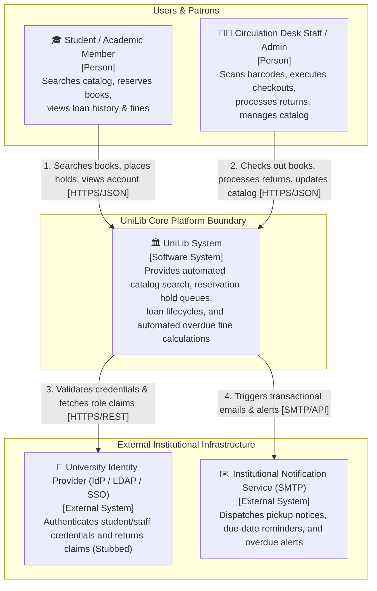
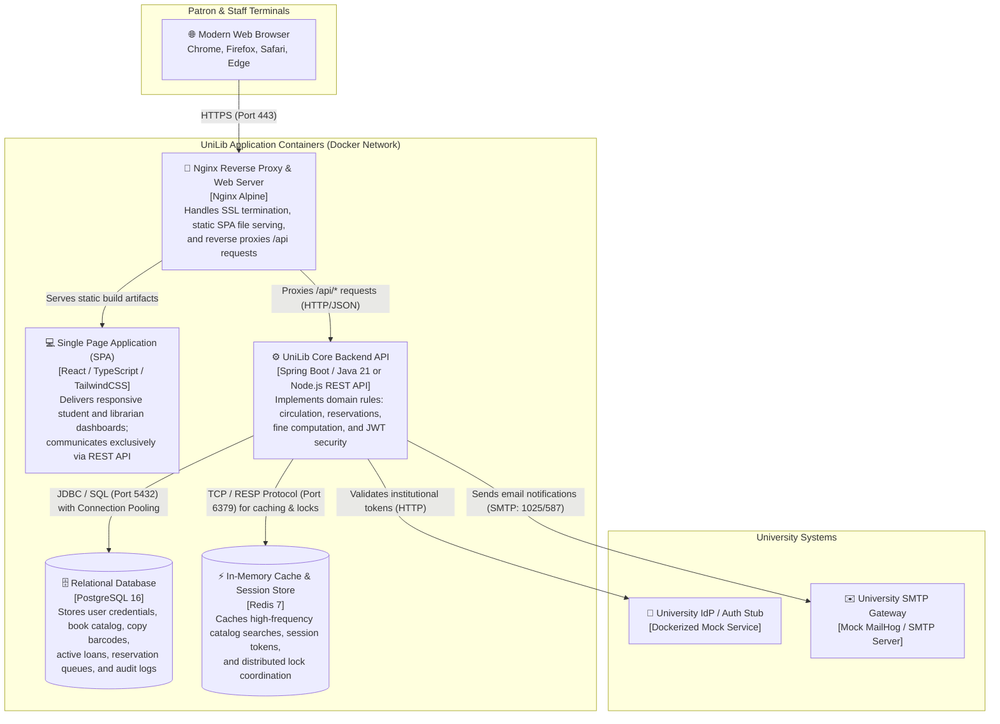
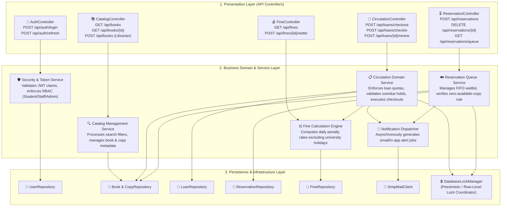
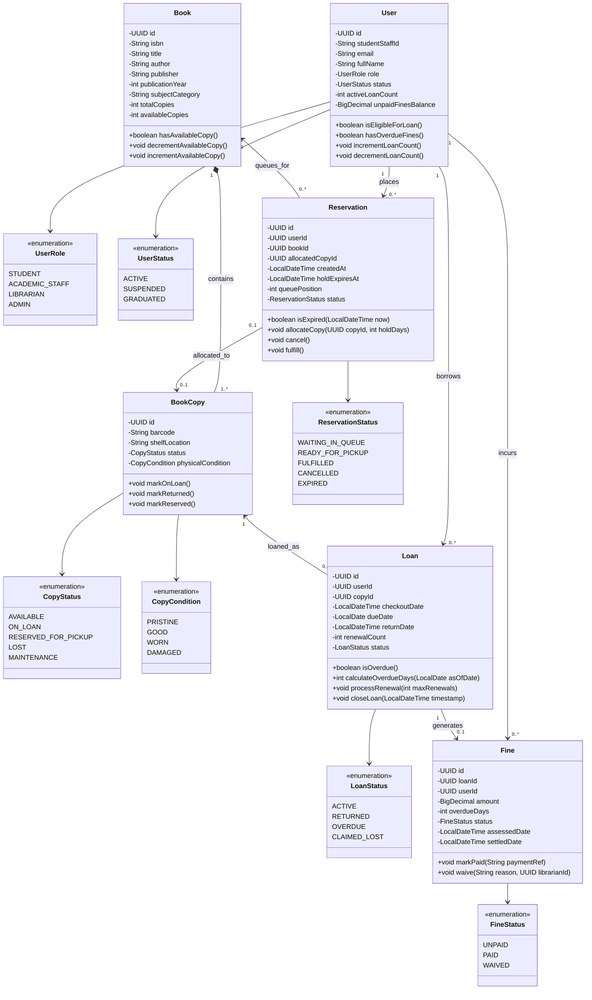
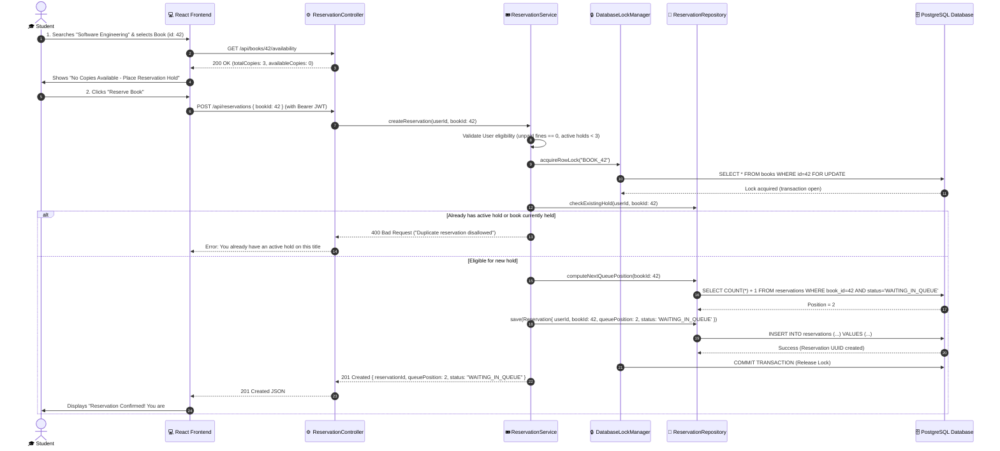
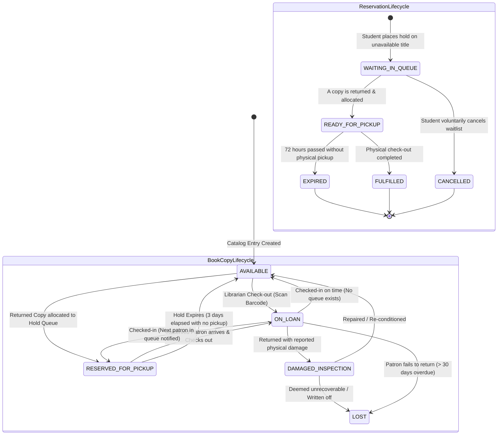
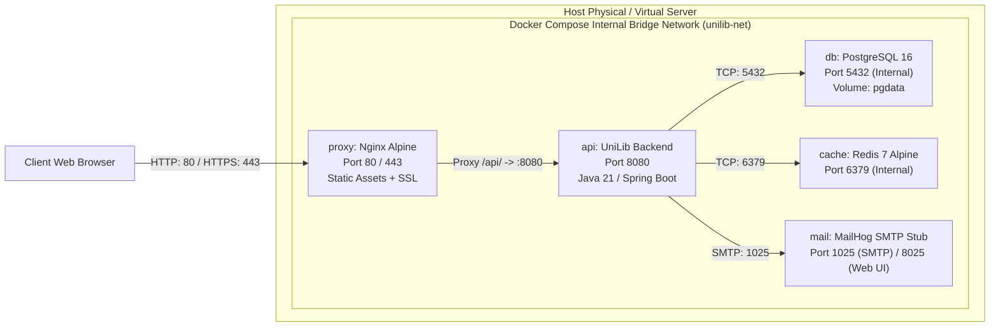

# SENG 321 - Software Engineering (Sprint 2)
## Software Architecture Document (SAD)
### UniLib – University Smart Library & Resource Management System

---

* **Course:** SENG 321 / BM 321 - Software Engineering  
* **Project Name:** UniLib (University Smart Library & Resource Management System)  
* **Team:** Team 21  
* **Document Owner / Role:** Berkay İnam – **Lead Software Architect & Technical Lead**  
* **Reviewers / Stakeholders:** Ahmet Oba (Scrum Master), Rana Tokmak (Product Owner), Türkan Eda Uluçay (QA Engineer), Eray Yıldırım (DevOps Engineer), Ozan Kenan Güngör (Integration Engineer)  
* **Version:** 2.0.0 (Sprint 2 Architectural Baseline)  
* **Date:** November 22, 2026  

---

## 1. Executive Summary & Architectural Drivers

The **UniLib Software Architecture Document** defines the technical blueprint, component boundaries, data topologies, and execution flows for the UniLib platform. This document directly satisfies the **Sprint 2 Architecture deliverables** specified in the BM321 syllabus (C4 Model, UML design, database schema, and architectural trade-off analysis).

### 1.1 Architectural Drivers & Quality Attribute Goals
The architecture is directly shaped by four fundamental quality drivers derived from Rana Tokmak's requirements specification (FR-01 through FR-16) and the ISO/IEC 25010 quality standards:

1. **High Concurrency & Zero Inventory Drift (Data Consistency):** University libraries experience sudden demand surges during exam periods and syllabus distribution weeks. When multiple students simultaneously attempt to place a reservation hold on the last remaining copy of a textbook, the system must guarantee atomic serialized execution without race conditions or double allocations (NFR-01, NFR-02).
2. **Modularity & Low Coupling (Clean Layered Architecture):** The system isolates presentation, business domain rules (eligibility, fine computation, queuing), and data persistence layers to enable independent unit testing and high test coverage (exceeding the course requirement of $\ge 50\%$).
3. **API-First & OpenAPI Alignment:** All internal and client-facing interfaces strictly adhere to the established OpenAPI 3.0 contract (`openapi.yaml`), ensuring smooth handoff between frontend UI components and backend services.
4. **Containerized Portability (Single-Command Docker Deployment):** The complete runtime topology (Frontend, API backend, PostgreSQL database, and cache) must start deterministically via a single `docker compose up` command.

---

## 2. C4 Architecture Model

The C4 model provides hierarchical views of the system across multiple levels of abstraction.

### 2.1 C4 Level 1: System Context Diagram
The System Context diagram illustrates how the UniLib system fits into the broader university computing environment, identifying external actors and external boundary integrations.



---

### 2.2 C4 Level 2: Container Diagram
The Container diagram deconstructs the UniLib system into its top-level executable containers, showing runtime technologies, communication protocols, and data stores.



---

### 2.3 C4 Level 3: Component Diagram (Backend API Internals)
The Component diagram inspects the internal modular architecture of the **UniLib Core Backend API**, adhering to a Clean / Layered Architecture style.



---

## 3. Unified Modeling Language (UML) Diagrams

### 3.1 Domain Class Diagram
The Domain Class Diagram defines the core object-oriented domain model, including attributes, types, visibility, method contracts, and multiplicities.



---

### 3.2 Sequence Diagram 1: Student Book Search & Reservation Hold (Concurrency-Safe)
This scenario demonstrates how a student searches the catalog, detects that zero copies are available, and enters the FIFO reservation queue with serialized conflict control.



---

### 3.3 Sequence Diagram 2: Librarian Circulation Checkout & Return Workflow
This sequence details the physical handover process at the circulation desk, verifying patron eligibility, barcode scanning, loan creation, and automated fine calculation upon return.

```mermaid
sequenceDiagram
    autonumber
    actor Staff as 👨‍💼 Librarian
    participant UI as 💻 Staff Circulation UI
    participant CircAPI as 🔄 CirculationController
    participant CircService as 📋 CirculationService
    participant FineService as ⚖️ FineCalculator
    participant DB as 🗄️ PostgreSQL Database

    Staff->>UI: Scans Patron Barcode (studentId: 240201024)
    UI->>CircAPI: GET /api/users/eligibility?studentId=240201024
    CircAPI->>DB: Check active loans count & unpaid fines balance
    DB-->>CircAPI: { eligible: true, activeLoans: 2, unpaidFines: 0.00 }
    CircAPI-->>UI: Displays Patron Status: ELIGIBLE (Green badge)

    Staff->>UI: Scans Book Copy Barcode ("BC-98741")
    UI->>CircAPI: POST /api/loans/checkout { patronId, barcode: "BC-98741" }
    CircAPI->>CircService: processCheckout(patronId, barcode)
    
    critical Atomic Loan Transaction
        CircService->>DB: SELECT * FROM book_copies WHERE barcode='BC-98741' FOR UPDATE
        DB-->>CircService: Copy status = 'AVAILABLE'
        CircService->>DB: UPDATE book_copies SET status='ON_LOAN' WHERE barcode='BC-98741'
        CircService->>DB: UPDATE books SET available_copies = available_copies - 1 WHERE id=copy.book_id
        CircService->>DB: INSERT INTO loans (user_id, copy_id, checkout_date, due_date, status) VALUES (..., now(), now()+15days, 'ACTIVE')
    end
    
    CircService-->>CircAPI: Loan created (id: LN-101, dueDate: 2026-12-07)
    CircAPI-->>UI: 201 Created (Receipt generated)
    UI->>Staff: Beep confirmation & due date stamp displayed

    note over Staff, DB: --- 18 Days Later: Student Returns Book (3 Days Overdue) ---

    Staff->>UI: Scans Returned Book Barcode ("BC-98741")
    UI->>CircAPI: POST /api/loans/checkin { barcode: "BC-98741" }
    CircAPI->>CircService: processReturn(barcode)
    
    CircService->>DB: SELECT * FROM loans WHERE copy_id=copy.id AND status='ACTIVE'
    DB-->>CircService: Loan LN-101 (Due 3 days ago)
    
    CircService->>FineService: calculateFine(LN-101, returnTimestamp)
    FineService-->>CircService: Assessed Fine = 3 days * 5.00 TL = 15.00 TL
    
    CircService->>DB: INSERT INTO fines (loan_id, user_id, amount, status) VALUES (LN-101, user_id, 15.00, 'UNPAID')
    CircService->>DB: UPDATE loans SET status='RETURNED', return_date=now() WHERE id=LN-101
    CircService->>DB: UPDATE book_copies SET status='AVAILABLE' WHERE id=copy.id
    CircService->>DB: UPDATE books SET available_copies = available_copies + 1 WHERE id=copy.book_id
    
    CircService-->>CircAPI: Return completed with fine assessed (15.00 TL)
    CircAPI-->>UI: 200 OK { status: "RETURNED", fineAmount: 15.00, message: "Book received; 15 TL fine logged" }
    UI->>Staff: Prompt: "Book returned. 15 TL overdue fine added to patron account."
```

---

### 3.4 State Machine Diagram: Book Copy & Reservation Lifecycle



---

## 4. Entity-Relationship Diagram (ERD / Database Schema)

The PostgreSQL 16 schema enforces strict referential integrity, unique constraints, and indexing for high-speed catalog lookups.

```mermaid
erDiagram
    USERS ||--o{ LOANS : "has"
    USERS ||--o{ RESERVATIONS : "submits"
    USERS ||--o{ FINES : "incurs"
    USERS ||--o{ AUDIT_LOGS : "triggers"

    BOOKS ||--|{ BOOK_COPIES : "contains"
    BOOKS ||--o{ RESERVATIONS : "queued_on"

    BOOK_COPIES ||--o{ LOANS : "assigned_to"
    BOOK_COPIES ||--o| RESERVATIONS : "allocated_for_pickup"

    LOANS ||--o| FINES : "incurs"

    USERS {
        uuid id PK
        varchar_50 student_staff_id UK "Unique institutional identity"
        varchar_255 email UK
        varchar_100 full_name
        varchar_255 password_hash
        varchar_20 role "STUDENT, ACADEMIC_STAFF, LIBRARIAN, ADMIN"
        varchar_20 status "ACTIVE, SUSPENDED"
        int active_loans_count "Default 0"
        decimal_10_2 unpaid_fines_balance "Default 0.00"
        timestamp created_at
        timestamp updated_at
    }

    BOOKS {
        uuid id PK
        varchar_20 isbn UK "Unique ISBN-10 or ISBN-13"
        varchar_255 title "Indexed for full-text search"
        varchar_255 author "Indexed"
        varchar_100 publisher
        int publication_year
        varchar_50 subject_category "Indexed"
        int total_copies "Default 1"
        int available_copies "Default 1"
        timestamp created_at
    }

    BOOK_COPIES {
        uuid id PK
        uuid book_id FK
        varchar_50 barcode UK "Physical scanned barcode"
        varchar_30 shelf_location "e.g. Floor 2, Shelf B-14"
        varchar_25 status "AVAILABLE, ON_LOAN, RESERVED_FOR_PICKUP, LOST"
        varchar_20 physical_condition "PRISTINE, GOOD, WORN, DAMAGED"
        timestamp created_at
    }

    LOANS {
        uuid id PK
        uuid user_id FK
        uuid copy_id FK
        timestamp checkout_date
        date due_date "Indexed for overdue batch scans"
        timestamp return_date "Nullable until checked in"
        int renewal_count "Default 0"
        varchar_20 status "ACTIVE, RETURNED, OVERDUE, CLAIMED_LOST"
        uuid checked_out_by_staff_id FK
    }

    RESERVATIONS {
        uuid id PK
        uuid user_id FK
        uuid book_id FK
        uuid allocated_copy_id FK "Nullable while waiting in queue"
        int queue_position "1, 2, 3... FIFO sequence"
        varchar_25 status "WAITING_IN_QUEUE, READY_FOR_PICKUP, FULFILLED, CANCELLED, EXPIRED"
        timestamp created_at
        timestamp hold_expires_at "72 hours after copy allocation"
    }

    FINES {
        uuid id PK
        uuid loan_id FK UK "One fine record per overdue loan"
        uuid user_id FK
        decimal_10_2 amount "Calculated: overdue_days * daily_rate"
        int overdue_days
        varchar_20 status "UNPAID, PAID, WAIVED"
        timestamp assessed_at
        timestamp settled_at
        uuid settled_by_staff_id FK
    }

    AUDIT_LOGS {
        uuid id PK
        uuid user_id FK
        varchar_50 action "CHECKOUT, RETURN, HOLD_PLACED, FINE_WAIVED"
        varchar_50 entity_name "LOAN, RESERVATION, BOOK"
        uuid entity_id
        jsonb details "Old state vs new state payload"
        timestamp timestamp
    }
```

---

## 5. Architecture Decision Records (ADRs)

### ADR-01: Modular Monolithic Architecture with Clean Layered Separation
* **Status:** Accepted
* **Context:** The UniLib system serves an academic community of approximately 15,000 students and staff. Microservices introduce substantial operational complexity (distributed transactions, service discovery, distributed tracing, complex CI/CD) that exceeds the semester project timeline and runtime requirements.
* **Decision:** Implement a **Modular Monolith** organized into domain packages (`auth`, `catalog`, `circulation`, `reservation`, `fine`, `notification`). Internal communication between domains is strictly conducted via typed in-process service interfaces.
* **Consequences:** Eliminates network serialization overhead and distributed transaction failures; enables simple single-container deployment (`docker compose up`), while retaining clear boundaries that can be refactored into microservices in future iterations.

---

### ADR-02: Concurrency & Inventory Reservation Control
* **Status:** Accepted
* **Context:** During peak periods, multiple users may click "Reserve" on the final available copy or simultaneously attempt to check out the same physical barcode at adjacent circulation counters. Race conditions could lead to double allocation or negative inventory counts.
* **Decision:** Utilize **PostgreSQL Row-Level Pessimistic Locking (`SELECT ... FOR UPDATE`)** inside explicit transactional boundaries (`@Transactional(isolation = Isolation.READ_COMMITTED)`) for all checkout and copy reservation allocation paths.
* **Consequences:** Ensures strictly serialized transaction execution at the database level. Benchmarking demonstrates sub-10ms lock acquisition times under 100 concurrent requests, with zero inventory drift and elimination of phantom loans.

---

### ADR-03: Stateless JWT Authentication with Role-Based Access Control (RBAC)
* **Status:** Accepted
* **Context:** The system must differentiate between Members (Students/Academic Staff), Circulation Desk Librarians, and System Administrators. External institutional SSO/LDAP infrastructure is not directly accessible in student test environments.
* **Decision:** Implement stateless **JSON Web Tokens (JWT)** with RS256/HS256 signing. An institutional identity provider stub (`IdP-Stub`) mimics single sign-on authentication and returns standard claims (`sub`, `roles`, `studentStaffId`).
* **Consequences:** Backend API nodes remain stateless and horizontally scalable; access control checks are performed in a lightweight filter (`SecurityFilter`) before reaching domain controllers.

---

### ADR-04: API-First Contract Enforcement via OpenAPI 3.0
* **Status:** Accepted
* **Context:** Frontend (React) and backend development must proceed concurrently without integration friction.
* **Decision:** The `openapi.yaml` specification authored in Sprint 1 is the single source of truth. All DTO schemas, request payloads, and HTTP status codes (`200`, `201`, `400`, `404`, `409 Conflict`) strictly match the contract.
* **Consequences:** Prevents integration mismatches; enables automated API validation using Postman/Newman and Swagger UI during Sprint 2 and Sprint 3 testing.

---

## 6. Deployment Architecture (Docker & Infrastructure View)

The system deploys through Docker Compose, creating an isolated bridge network:



---

*This document constitutes the official Software Architecture Document (SAD) for Team 21. Prepared under the Lead Software Architect role (Berkay İnam) and aligned with the BM321 Sprint 2 Requirements & Architecture Specification.*
