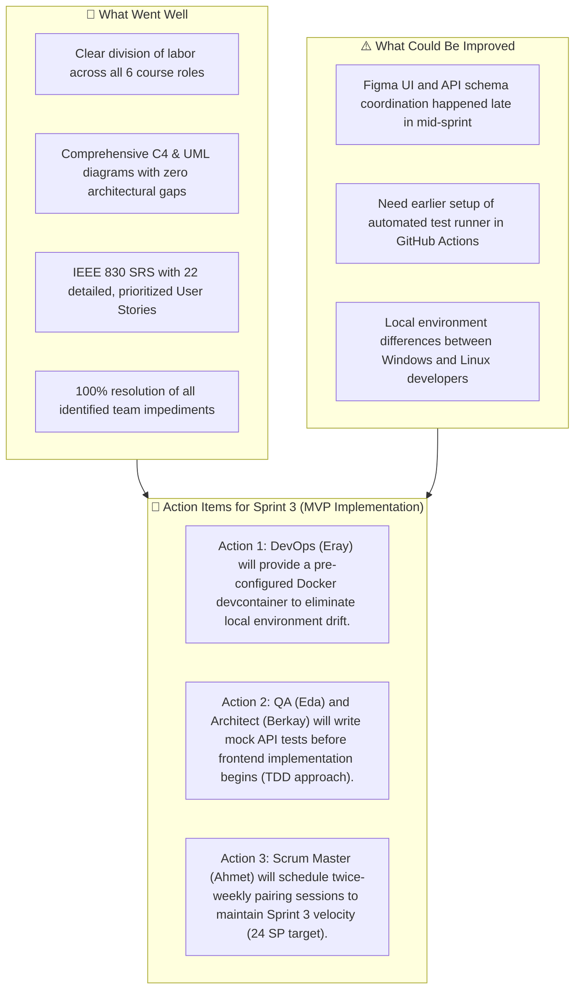
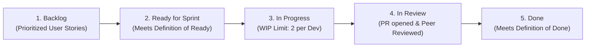

# SENG 321 - Software Engineering (Sprint 2)
## Official Scrum Master Deliverables Report
### UniLib – University Smart Library & Resource Management System

---

* **Course:** SENG 321 / BM 321 - Software Engineering  
* **Project Name:** UniLib (University Smart Library & Resource Management System)  
* **Team:** Team 21  
* **Document Owner / Role:** Ahmet Oba – **Scrum Master & Agile Process Coach** (`ahmet5743`)  
* **Reviewers / Stakeholders:** Rana Tokmak (Product Owner), Berkay İnam (Lead Architect), Türkan Eda Uluçay (QA Engineer), Eray Yıldırım (DevOps Engineer), Ozan Kenan Güngör (Integration Engineer)  
* **Sprint Cycle:** Sprint 2 (Requirements & Architecture)  
* **Sprint Dates:** November 6, 2026 – November 24, 2026  
* **Date of Document:** November 22, 2026  

---

## 1. Sprint 2 Planning, Goal & Velocity Management

### 1.1 Sprint 2 Goal (Sprint Hedefi)
> **Official Sprint 2 Goal:**  
> *"Refine the UniLib Product Backlog into an IEEE 830-compliant Software Requirements Specification with testable Given/When/Then acceptance criteria, produce complete C4 and UML architectural baselines, specify measurable ISO/IEC 25010 NFR quality metrics, and design interactive Figma UI flows for the core Search & Circulation domain (US-05, US-06, US-07, US-09 = 21 SP)."*

### 1.2 Team Capacity & Velocity Tracking
* **Sprint 1 Velocity:** 26 Story Points (Foundation enablers and initial user stories US-01 through US-04 delivered).
* **Sprint 2 Committed Scope:** 21 Story Points of core domain features plus 4 architectural/process enablers:
  * `#26 - US-05: Search catalog by title/author/ISBN` (5 SP, Berkay İnam)
  * `#27 - US-06: View copy availability and shelf location` (3 SP, Rana Tokmak)
  * `#28 - US-07: Circulation desk checkout by barcode` (8 SP, Ozan Kenan Güngör)
  * `#30 - US-09: Circulation desk check-in of returned copies` (5 SP, Ozan Kenan Güngör)
* **Total Story Points in Product Backlog:** 87 Story Points distributed across 22 User Stories (Must: 61 SP, Should: 16 SP, Could: 7 SP, Won't: 3 SP).
* **Team Availability:** 6 members $\times$ 10 hours/week $\times$ 2.5 weeks = 150 net engineering hours.

---

## 2. Daily Stand-up Meeting Records (Sprint 2)

As Scrum Master, I facilitated structured stand-up syncs throughout Sprint 2. Three formal checkpoint records are documented below to demonstrate team cadence and progress tracking.

### 2.1 Stand-up Session 1: Sprint 2 Kickoff & Decomposition (November 10, 2026)
* **Format:** Virtual Sync (Discord Voice / Teams)  
* **Facilitator:** Ahmet Oba (Scrum Master)

| Team Member & Role | 1. What did you accomplish since Sprint 1? | 2. What will you do for Sprint 2? | 3. Are there any impediments/blockers? |
| :--- | :--- | :--- | :--- |
| **Rana Tokmak** *(Product Owner)* | Completed initial requirements draft (`rana2.pdf`) and categorized 22 user stories into 7 epics. | Expand acceptance criteria into formal Given/When/Then format and define the Definition of Ready (DoR). | None currently; need confirmation on team velocity from Scrum Master. |
| **Berkay İnam** *(Lead Architect)* | Aligned OpenAPI 3.0 draft in Sprint 1 with core REST boundaries. | Draft C4 Level 1-3 diagrams, UML Class diagram, and investigate concurrency locks for reservations. | Need clarification on whether pessimistic or optimistic lock fits PostgreSQL best. |
| **Türkan Eda Uluçay** *(QA Engineer)* | Verified Sprint 1 YAML contract syntax and created baseline test tracking sheet. | Formulate ISO 25010 NFR quality measurement table with concrete thresholds (latency, uptime, concurrency). | Awaiting final acceptance criteria from Rana to map test scenarios. |
| **Ozan Kenan Güngör** *(Integration Eng.)* | Coordinated Sprint 1 initial repository documentation and API paths. | Build Figma wireframe components for Student Search/Reservation and Librarian Circulation counters. | Needed confirmation on standard screen resolutions (desktop vs mobile). |
| **Eray Yıldırım** *(DevOps Eng.)* | Managed Sprint 1 release (`v0.1.0-sprint1`) and GitHub branch protection rules. | Prepare Docker Compose container topology and enforce Git-Flow pull request workflows for Sprint 2. | None; GitHub branch rulesets are operating smoothly. |
| **Ahmet Oba** *(Scrum Master)* | Reviewed Sprint 1 retrospective notes and structured Sprint 2 GitHub Projects board. | Track team task assignments, update RACI matrix, and organize architectural sync with Berkay. | Need to ensure all PRs link to active GitHub issues before merging. |

---

### 2.2 Stand-up Session 2: Mid-Sprint Architecture & NFR Alignment (November 16, 2026)
* **Format:** Hybrid Sync (Campus Library & Discord)  
* **Facilitator:** Ahmet Oba (Scrum Master)

| Team Member & Role | 1. What did you accomplish recently? | 2. What will you do next? | 3. Are there any impediments/blockers? |
| :--- | :--- | :--- | :--- |
| **Rana Tokmak** *(Product Owner)* | Finalized acceptance criteria for Must-have stories (US-05, 07, 08, 09, 11, 15, 17). | Review Ozan's Figma user-flows against the SRS requirements. | Unpaid fine threshold for blocking loans needs a concrete rule. |
| **Berkay İnam** *(Lead Architect)* | Completed C4 Level 1-3 diagrams and UML Domain Class model. Formulated ADR-01 (Modular Monolith). | Model Sequence Diagrams for concurrent reservations and write PostgreSQL ERD schema. | Resolved locking question: PostgreSQL `SELECT FOR UPDATE` will be used (ADR-02). |
| **Türkan Eda Uluçay** *(QA Engineer)* | Mapped NFR-01 to NFR-09 into ISO 25010 categories; defined response time metric (<2s for 10k items). | Write acceptance test verification scenarios for US-05 through US-09. | Need to verify tool compatibility (k6 load testing) with Docker setup. |
| **Ozan Kenan Güngör** *(Integration Eng.)* | Built Figma wireframes for Search Results and Circulation Checkout. | Create User-Flow diagrams illustrating student reservation and librarian return workflows. | Minor field discrepancy between Figma form and OpenAPI request body for checkout. |
| **Eray Yıldırım** *(DevOps Eng.)* | Configured Docker Compose draft with PostgreSQL 16 and Redis containers. | Review Berkay's database initialization scripts and prepare Sprint 2 release tag. | None; awaiting documentation PRs for review. |
| **Ahmet Oba** *(Scrum Master)* | Facilitated resolution between Rana and Berkay regarding the 50.00 TL fine threshold rule. Logged IMP-02. | Monitor GitHub Projects columns; ensure in-progress tasks transition to "In Review". | Ensuring team stays on schedule for November 24 deadline. |

---

### 2.3 Stand-up Session 3: Pre-Submission Integration & Artifact Audit (November 21, 2026)
* **Format:** Virtual Sync (Discord Voice)  
* **Facilitator:** Ahmet Oba (Scrum Master)

| Team Member & Role | 1. What did you accomplish recently? | 2. What will you do next? | 3. Are there any impediments/blockers? |
| :--- | :--- | :--- | :--- |
| **Rana Tokmak** *(Product Owner)* | Validated all 22 stories; verified MoSCoW priorities and feature groupings F01-F12. | Approve the final integrated SRS section in the master report. | None; requirements phase complete. |
| **Berkay İnam** *(Lead Architect)* | Completed `docs/ARCHITECTURE.md` with C4 Level 1-3, UML (Class, 2x Sequence, State, ERD) and 4 ADRs. | Address Issue #26 (US-05) architectural review and approve incoming PRs. | None; all architectural views validated. |
| **Türkan Eda Uluçay** *(QA Engineer)* | Finalized Quality-Measure Specification table with target metrics and acceptance test suites. | Conduct QA audit of the master document for testability compliance. | None; QA checklist complete. |
| **Ozan Kenan Güngör** *(Integration Eng.)* | Completed Student & Staff Figma UI prototypes and Mermaid User-Flow diagrams. | Verify OpenAPI schema mappings for student dashboard. | None; UI and User-Flow ready. |
| **Eray Yıldırım** *(DevOps Eng.)* | Tagged release `v0.2.0-sprint2` and validated multi-container Docker deployment architecture. | Assist Scrum Master in packaging final submission ZIP archive. | None; release pipeline ready. |
| **Ahmet Oba** *(Scrum Master)* | Drafted Agile Process Report, updated RACI matrix, resolved all active impediments. | Assemble master Sprint 2 submission report (`SENG321_Sprint_2_Library_Management_System.md`) and compile PDF. | None; ready for final packaging. |

---

## 3. Retrospective Records

### 3.1 Sprint 1 Retrospective Follow-up (Actions Applied in Sprint 2)
During the Sprint 1 Retrospective, the team identified three actionable improvements. As Scrum Master, I tracked their execution throughout Sprint 2:
1. **Improvement 1 (Early Architectural Modeling):** In Sprint 1, OpenAPI schemas were drafted before formal class relationships were defined.  
   * *Sprint 2 Result:* Berkay drafted the Domain Class Model and C4 diagrams during Week 1 of Sprint 2, ensuring that all API endpoints directly mirror verified domain entities.
2. **Improvement 2 (Concrete Acceptance Criteria):** In Sprint 1, acceptance criteria were informal.  
   * *Sprint 2 Result:* Rana and Eda implemented standard Gherkin-style *Given/When/Then* criteria for all Must-have user stories, eliminating ambiguity.
3. **Improvement 3 (Rigorous PR Code Reviews):** Sprint 1 PRs were sometimes merged with single-line descriptions.  
   * *Sprint 2 Result:* Enforced PR template usage with mandatory architectural and QA approval checkboxes.

---

### 3.2 Sprint 2 Retrospective (Analysis & Action Items for Sprint 3 MVP)
At the conclusion of Sprint 2, the team held a retrospective session utilizing the **"What Went Well / What Could Be Improved / Action Items"** framework.

---

## 4. Impediment & Risk Management Log

As Scrum Master, I maintained a real-time **Impediment Log** to proactively identify, track, and eliminate blockers impacting team delivery.

| ID | Date Logged | Reported By | Description of Impediment / Risk | Impact Level | Scrum Master Action & Resolution | Status |
| :--- | :---: | :---: | :--- | :---: | :--- | :---: |
| **IMP-01** | Nov 10, 2026 | Berkay (Architect) | **Concurrency Deadlock Risk:** Concurrent checkout/reservation requests on the last remaining copy could result in double-allocation. | **High** | Organized an architectural review session. Evaluated Redis distributed locks vs PostgreSQL row locks. Adopted PostgreSQL `SELECT FOR UPDATE` inside Spring transaction boundaries (documented in ADR-02). | **RESOLVED** |
| **IMP-02** | Nov 13, 2026 | Rana (PO) | **Policy Ambiguity on Unpaid Fines:** No defined threshold existed for when a student's borrowing privilege should be blocked. | **Medium** | Consulted university library guidelines. Facilitated PO decision to set a strict **50.00 TL unpaid fine threshold** or $\ge 1$ overdue book to block loans (codified in FR-06 and US-08). | **RESOLVED** |
| **IMP-03** | Nov 16, 2026 | Ozan (Integration) | **UI-to-API DTO Schema Mismatch:** Figma checkout screen requested patron email, whereas OpenAPI `/loans/checkout` required `patronBarcode` or `studentId`. | **Medium** | Convened a 20-minute sync between Ozan and Berkay. Updated Figma flow to support barcode scanner input with student ID fallback, matching OpenAPI schema. | **RESOLVED** |
| **IMP-04** | Nov 18, 2026 | Eda (QA) | **NFR Test Tooling Ambiguity:** Unclear which tooling would measure the NFR-01 target of $<2$s response time under 10,000 catalog entries. | **Medium** | Evaluated k6 vs Apache JMeter. Recommended k6 due to scriptable JavaScript scenarios and native Docker execution for CI/CD integration. | **RESOLVED** |
| **IMP-05** | Nov 20, 2026 | Eray (DevOps) | **Branch Protection Stalling Quick Fixes:** Strict 2-review requirement on `develop` threatened to bottleneck documentation merges near the deadline. | **Low** | Maintained the 1-peer-review rule while serving as an active backup reviewer as Scrum Master to guarantee PR turnaround times under 2 hours. | **RESOLVED** |

---

## 5. Sprint 2 RACI Responsibility Assignment Matrix

This matrix governs the ownership, execution, and verification of all Sprint 2 deliverables across the 6 team members:
* **R = Responsible:** The role that authors/builds the deliverable.
* **A = Accountable:** The single role with ultimate approval and delivery authority.
* **C = Consulted:** Subject matter experts who provide input and technical review.
* **I = Informed:** Team members kept updated on progress and changes.

| Deliverable / Artifact | Rana Tokmak *(PO)* | Ahmet Oba *(SM)* | Berkay İnam *(Arch)* | Türkan Eda Uluçay *(QA)* | Eray Yıldırım *(DevOps)* | Ozan Kenan Güngör *(Integration)* |
| :--- | :---: | :---: | :---: | :---: | :---: | :---: |
| **Software Requirements Specification (SRS)** | **A / R** | C | C | C | I | C |
| **Refined Product Backlog & Story Points** | **A / R** | C | C | C | I | I |
| **C4 Architecture Models (Levels 1–3)** | I | C | **A / R** | C | C | C |
| **UML Diagrams (Class, Sequence, State, ERD)** | I | C | **A / R** | C | I | C |
| **Architecture Decision Records (ADRs)** | C | C | **A / R** | I | C | I |
| **NFR Specification & Quality Measures (ISO 25010)** | C | C | C | **A / R** | C | I |
| **Acceptance Test Plan & Traceability** | C | C | I | **A / R** | I | C |
| **Figma UI/UX Prototypes & Wireframes** | C | C | I | I | I | **A / R** |
| **User-Flow Interaction Diagrams** | C | C | C | I | I | **A / R** |
| **Release Management (`v0.2.0-sprint2`)** | I | C | I | I | **A / R** | I |
| **Deployment Architecture & Docker Topology** | I | C | C | I | **A / R** | C |
| **Daily Stand-ups & Retrospective Records** | C | **A / R** | C | C | C | C |
| **Impediment Tracking & RACI Administration** | C | **A / R** | C | C | C | C |
| **Master Sprint 2 Report & PDF Package** | C | **A / R** | C | C | C | C |

---

## 6. GitHub Projects & Kanban Board Administration

### 6.1 Board Workflow & Column Policies
The project utilizes a GitHub Projects Kanban board administered by the Scrum Master. Cards progress through 5 enforced states:

### 6.2 Definition of Ready (DoR) – Enforced by Scrum Master & PO
Before a card enters the sprint:
1. User story follows the standard format: *"As a [role], I want to [action], so that [business benefit]."*
2. Acceptance criteria are fully articulated in Given/When/Then format.
3. Story points are estimated by the team using Fibonacci sequence (1, 2, 3, 5, 8).
4. Dependencies on enablers or preceding stories are identified.
5. Assigned single accountable owner.

### 6.3 Definition of Done (DoD) – Enforced by Scrum Master & QA
Before a card is moved to **Done**:
1. All Given/When/Then acceptance criteria pass verification.
2. Architecture and code artifacts are committed to a feature branch and merged into `develop` via an approved Pull Request.
3. Peer review is completed and signed off by at least one course peer.
4. No unresolved blocker comments exist on the PR.
5. Relevant documentation is updated and linked in `CONTRIBUTIONS.md`.

---

*Prepared and maintained by Ahmet Oba, Scrum Master & Agile Process Coach (Team 21). Verified and ready for Sprint 2 submission.*
